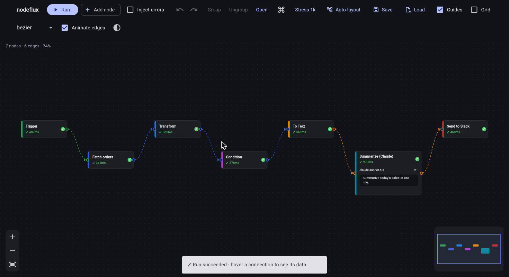

# nodeflux

[](https://github.com/Prajit7/nodeflux/actions/workflows/ci.yml)



A fast, widget-based **node & flow editor for Flutter** — built for workflow, automation and AI-agent builders.

- Infinite canvas: pan, zoom (wheel, trackpad, pinch), animated fit-to-view
- Nodes are **any Flutter widget**; only visible nodes are built
- **Typed ports** — invalid connections are refused with a reason
- Bezier / smoothstep / step / straight edges with **flowing dash animation**
- **Run status** on nodes (running · success · error · skipped) and **data pulses** along edges
- Hover a connection to **preview the data** it carried
- Drop a connection on empty space → **compatible-node picker**; right-click / double-click to add nodes
- **Configurable custom nodes** with real text fields, dropdowns, buttons (`FlowInteractive`)
- Multi-select (click, Shift-click, **Shift-drag box**), delete, **undo / redo** (⌘Z / ⌘⇧Z)
- **Copy / cut / paste / duplicate** (⌘C ⌘X ⌘V ⌘D)
- Drag a selected edge's end to **reconnect** it; drop a node onto an edge to **insert** it
- **Smart alignment guides** and optional grid snap
- **Minimap**, zoom controls and stats overlays
- **JSON save / load** and one-call **auto-layout**
- **Sub-flows**: group nodes (⌘G), double-click to open, breadcrumb to go back
- **⌘K command palette** with built-in and your own actions
- **Edge labels**
- **Fast**: spatial index + per-node widget caching — 1,000+ nodes stay smooth
- Light & dark themes, all 6 platforms, **zero dependencies** beyond Flutter

## Hello flow

```dart
const json = PortType('json', Colors.blue);
const ports = [Port(id: 'in', side: PortSide.left, type: json), Port(id: 'out', side: PortSide.right, type: json)];

final flow = FlowController(
  nodes: [
    const FlowNode(id: 'a', position: Offset(0, 0), type: 'step', label: 'Fetch', ports: ports),
    const FlowNode(id: 'b', position: Offset(260, 80), type: 'step', label: 'Transform', ports: ports),
  ],
  edges: [const FlowEdge(id: 'e1', sourceNode: 'a', sourcePort: 'out', targetNode: 'b', targetPort: 'in')],
);

FlowCanvas(
  controller: flow,
  nodeBuilder: (context, node) => DefaultFlowNode(node: node, accent: Colors.blue),
);
```

## Custom, configurable nodes

Any widget can be a node. Wrap interactive parts (text fields, dropdowns,
switches, buttons) in `FlowInteractive` so they receive clicks and typing;
the rest of the node still drags. Store settings in `node.data`:

```dart
nodeBuilder: (context, node) => DefaultFlowNode(
  node: node,
  accent: Colors.teal,
  child: FlowInteractive(
    child: TextFormField(
      initialValue: (node.data as Map)['prompt'],
      onChanged: (v) => flow.updateNode(node.copyWith(data: {'prompt': v}), record: false),
    ),
  ),
),
```

Give such nodes a taller `size` (e.g. `Size(260, 172)`). Canvas shortcuts
(Delete, ⌘Z…) are ignored while a field inside a node has focus.

## Adding nodes

- `flow.addNode(node)` from your own UI (toolbar, sidebar, palette)
- `onCanvasMenu: (context, worldPosition) {…}` — right-click or double-click on empty canvas
- `onConnectEndEmpty` — drop a connection on empty space; return the new node
- `showNodePicker(context, templates: …, from: portType)` — ready-made menu

## Overlays

Put them in a `Stack` over the canvas:

```dart
final canvasKey = GlobalKey<FlowCanvasState>();
final viewport = FlowViewport();

Stack(children: [
  FlowCanvas(key: canvasKey, controller: flow, viewport: viewport, nodeBuilder: …),
  Positioned(right: 16, bottom: 16, child: FlowMinimap(controller: flow, viewport: viewport, canvas: canvasKey)),
  Positioned(left: 16, bottom: 16, child: FlowControls(canvas: canvasKey, viewport: viewport)),
  Positioned(left: 16, top: 12, child: FlowStats(controller: flow, viewport: viewport)),
]);
```

## Save, load and layout

```dart
final json = flow.toJson();                                  // JSON-safe map (no run state)
flow.loadJson(json, portTypes: {'json': jsonType});          // replace in place
final copy = FlowController.fromJson(json, portTypes: {...}); // or a new controller

flow.autoLayout();              // one undo step
canvasKey.currentState!.fitView();
```

## Sub-flows

```dart
flow.groupSelection(label: 'Fetch & clean'); // ⌘G — crossing edges become group ports
flow.enter(groupId);                         // or double-click the group
flow.exit();                                 // or Esc / tap a breadcrumb
flow.ungroup(groupId);                       // ⌘⇧G
```

Show where you are with `FlowBreadcrumb(controller: flow)`. Sub-flows are
saved in JSON, and each level has its own undo history.

## Command palette

⌘K opens it. Add your own entries:

```dart
FlowCanvas(
  paletteActions: () => [
    FlowAction(label: 'Add: HTTP Request', color: Colors.blue, run: () => …),
  ],
  …
);
```

## Showing run state

Your app runs the flow; nodeflux shows it:

```dart
flow.setStatus('a', NodeStatus.running);
flow.setStatus('a', NodeStatus.success, duration: d, output: {'items': 3});
flow.pulseEdge('e1'); // glowing dot travels along the edge
```

See `example/` for a full workflow editor demo.

## License

MIT
