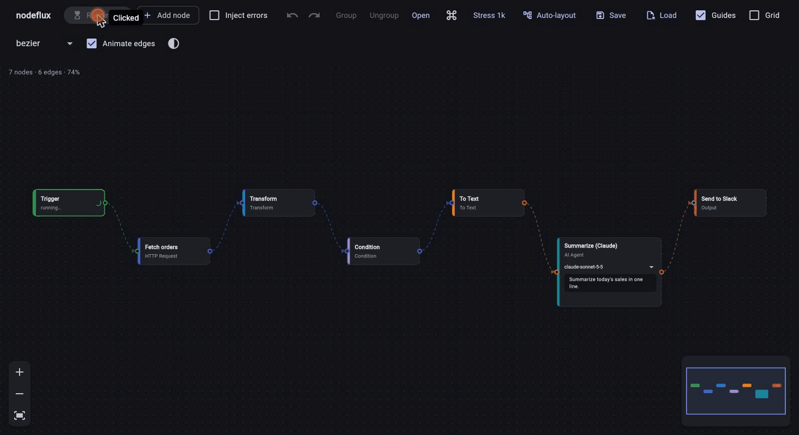

# nodeflux

[](https://pub.dev/packages/nodeflux)
[](https://github.com/Prajit7/nodeflux/actions/workflows/ci.yml)
[](https://github.com/Prajit7/nodeflux/blob/main/LICENSE)
[](https://nodeflux-demo.vercel.app)

A fast, widget-based **node & flow editor for Flutter** — think React Flow, built for
**workflow, automation and AI-agent builders**. Typed ports, animated edges, live run
status, sub-flows, undo/redo — with **zero dependencies** beyond Flutter.

### ▶ [Try the live demo](https://nodeflux-demo.vercel.app)



<sub>Run the flow (live status + data pulses) · hover a connection to see its data · group into a sub-flow and open it · auto-layout.</sub>

---

## Features

| | |
|---|---|
| 🖐 **Canvas** | Infinite pan & zoom (wheel, trackpad, pinch), animated fit-to-view, dot / line grid, minimap, zoom controls |
| 🧩 **Nodes** | **Any Flutter widget** — including text fields, dropdowns and buttons (`FlowInteractive`); ready-made `DefaultFlowNode` |
| 🔌 **Typed ports** | Connections are checked by type; invalid drops are refused **with a reason** |
| 〰️ **Edges** | Bezier · smoothstep · step · straight, arrows, labels, **flowing dash animation** |
| ⚡ **Run status** | Running · success · error · skipped on each node, **glowing data pulses** along edges, hover to **preview the data** |
| ✏️ **Editing** | Multi-select & box-select, copy / paste / duplicate, **undo / redo**, reconnect edges, drop a node on an edge to insert it |
| 📐 **Layout** | Smart alignment guides, grid snap, one-call **auto-layout** |
| 📦 **Sub-flows** | Group nodes into one (⌘G), double-click to open, breadcrumb to go back |
| ⌨️ **Command palette** | ⌘K with built-in actions plus your own |
| 💾 **Save / load** | JSON in, JSON out — including sub-flows and your own node data |
| 🚀 **Fast** | Spatial index + per-node widget caching; 1,000+ nodes stay smooth |
| 🎨 **Themes** | Light & dark out of the box, fully customisable `FlowTheme` |

Works on **Android, iOS, Web, macOS, Windows and Linux**.

## Install

```yaml
dependencies:
  nodeflux: ^0.1.0
```

```dart
import 'package:nodeflux/nodeflux.dart';
```

## Quick start

A complete, runnable app:

```dart
import 'package:flutter/material.dart';
import 'package:nodeflux/nodeflux.dart';

void main() => runApp(const MaterialApp(home: HelloFlow()));

const json = PortType('json', Colors.blue);
const ports = [
  Port(id: 'in', side: PortSide.left, type: json),
  Port(id: 'out', side: PortSide.right, type: json),
];

class HelloFlow extends StatefulWidget {
  const HelloFlow({super.key});
  @override
  State<HelloFlow> createState() => _HelloFlowState();
}

class _HelloFlowState extends State<HelloFlow> {
  final flow = FlowController(
    nodes: const [
      FlowNode(id: 'a', position: Offset(0, 0), type: 'step', label: 'Fetch', ports: ports),
      FlowNode(id: 'b', position: Offset(260, 80), type: 'step', label: 'Transform', ports: ports),
    ],
    edges: const [
      FlowEdge(id: 'e1', sourceNode: 'a', sourcePort: 'out', targetNode: 'b', targetPort: 'in'),
    ],
  );

  @override
  Widget build(BuildContext context) => Scaffold(
        body: FlowCanvas(
          controller: flow,
          nodeBuilder: (context, node) => DefaultFlowNode(
            node: node,
            accent: Colors.blue,
            selected: flow.selectedNodes.contains(node.id),
          ),
        ),
      );
}
```

Drag nodes, drag from the right ● to another node to connect, scroll to zoom,
⌘Z to undo.

## Keyboard & mouse

| Action | Shortcut |
|---|---|
| Pan / zoom | Drag empty canvas · scroll, pinch or trackpad |
| Connect | Drag from an output port (touch: long-press it first) |
| Box select | Shift + drag |
| Add node | Right-click or double-click empty canvas · drop a connection on empty space |
| Undo / redo | ⌘Z / ⌘⇧Z (Ctrl on Windows/Linux) |
| Copy · cut · paste · duplicate | ⌘C · ⌘X · ⌘V · ⌘D |
| Select all · delete | ⌘A · Delete / Backspace |
| Group · ungroup | ⌘G · ⌘⇧G |
| Open sub-flow · go back | Double-click group · Esc |
| Command palette | ⌘K |

## Custom, configurable nodes

Any widget can be a node. Wrap interactive parts (text fields, dropdowns,
switches, buttons) in `FlowInteractive` so they receive clicks and typing; the
rest of the node still drags. Store settings in `node.data`:

```dart
nodeBuilder: (context, node) => DefaultFlowNode(
  node: node,
  accent: Colors.teal,
  child: FlowInteractive(
    child: TextFormField(
      initialValue: (node.data as Map)['prompt'],
      onChanged: (v) => flow.updateNode(node.copyWith(data: {'prompt': v}), record: false),
    ),
  ),
),
```

Give such nodes a taller `size` (e.g. `Size(260, 172)`). Canvas shortcuts are
ignored while a field inside a node has focus.

## Showing run state

Your app runs the flow; nodeflux shows it:

```dart
flow.setStatus('a', NodeStatus.running);
flow.setStatus('a', NodeStatus.success, duration: elapsed, output: {'items': 3});
flow.pulseEdge('e1'); // glowing dot travels along the edge
```

Hover any connection to see the source node's `output`.

## Adding nodes

- `flow.addNode(node)` from your own UI (toolbar, sidebar…)
- `onCanvasMenu: (context, worldPosition) {…}` — right-click / double-click on empty canvas
- `onConnectEndEmpty` — drop a connection on empty space; return the new node
- `showNodePicker(context, templates: …, from: portType)` — ready-made menu listing compatible nodes

## Overlays

```dart
final canvasKey = GlobalKey<FlowCanvasState>();
final viewport = FlowViewport();

Stack(children: [
  FlowCanvas(key: canvasKey, controller: flow, viewport: viewport, nodeBuilder: …),
  Positioned(right: 16, bottom: 16, child: FlowMinimap(controller: flow, viewport: viewport, canvas: canvasKey)),
  Positioned(left: 16, bottom: 16, child: FlowControls(canvas: canvasKey, viewport: viewport)),
  Positioned(left: 16, top: 12, child: FlowStats(controller: flow, viewport: viewport)),
  Positioned(top: 12, left: 0, right: 0, child: Center(child: FlowBreadcrumb(controller: flow))),
]);
```

## Save, load and layout

```dart
final saved = flow.toJson();                              // JSON-safe map (no run state)
flow.loadJson(saved, portTypes: {'json': json});          // replace in place
final copy = FlowController.fromJson(saved, portTypes: {'json': json});

flow.autoLayout();                                        // one undo step
canvasKey.currentState!.fitView();
```

## Sub-flows

```dart
flow.groupSelection(label: 'Fetch & clean'); // ⌘G — edges crossing the selection become group ports
flow.enter(groupId);                         // or double-click the group
flow.exit();                                 // or Esc / tap a breadcrumb
flow.ungroup(groupId);                       // ⌘⇧G
```

Sub-flows are saved in JSON, and each level has its own undo history.

## Command palette

⌘K opens it. Add your own entries:

```dart
FlowCanvas(
  paletteActions: () => [
    FlowAction(label: 'Add: HTTP Request', color: Colors.blue, run: () => …),
  ],
  …
);
```

## Example

The [example app](https://github.com/Prajit7/nodeflux/tree/main/example) is a full
workflow editor — the same one running in the
[live demo](https://nodeflux-demo.vercel.app).

## Contributing

Issues and pull requests are welcome on
[GitHub](https://github.com/Prajit7/nodeflux).

## License

[MIT](https://github.com/Prajit7/nodeflux/blob/main/LICENSE)
